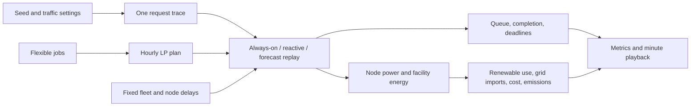

# GridShift simulation guide

This guide describes the implementation in this repository, not a measured data-center model. The simulation is a deterministic experiment: hold one generated request trace and one flexible-work plan fixed, then compare node-control policies against them. Its numbers are useful for understanding timing, constraints, and tradeoffs in this model. They are not a service guarantee, site forecast, or validated energy estimate.

## What the simulation does

Each run creates (or accepts) a day-long request trace, a fixed 24-hour flexible-work schedule, and a homogeneous GPU fleet. It then replays the same minute-by-minute workload under three node policies: always-on, reactive, and forecast. The controllers see the same arrivals and flexible commitments. Each policy separately determines which nodes are active, warm, starting, or off, and therefore how much demand can start at each minute.



## Inputs and traffic generation

The default run has seed `2026`, 32 nodes, 8 GPUs per node, normal traffic, a target of two warm standby nodes, EWMA alpha `0.3`, fallback forecast margin `max(4 GPUs, 15% of predicted demand)`, minimum-active floor `25%`, and seeded-burst chance enabled. The UI also offers a fixed 16-node headroom fixture when the base inventory is at most 48 nodes. Inventory is fixed during replay; “headroom” does not add nodes in response to future demand.

Traffic presets change the arrival rate only: Low is `0.5×`, Normal `1×`, High `2×`. They do not change node count, GPUs per node, job classes, sizes, duration draws, power, tariffs, or emissions. With an explicit request trace, the preset multiplier is ignored.

The generator groups arrivals into five-minute buckets. At each bucket start it draws an independent Poisson count for each of two classes using the class rate, time-of-day multiplier, traffic multiplier, and optional burst multiplier. Each request is placed at a random minute within the bucket. The class inputs are:

| Class | Mean rate per 5 min before time-of-day and traffic scaling | GPUs/request | Duration draw, minutes | Response allowance |
|---|---:|---:|---:|---:|
| Interactive | 6 | 1–2, uniform integer | triangular 2 / 5 / 8 (minimum / typical / maximum) | 2 min |
| Batch | 2 | 2–4, uniform integer | triangular 5 / 15 / 30 | 30 min |

The time multiplier is `0.35` before 06:00, `0.6` from 06:00–08:59, `1.0` from 09:00–16:59, `1.5` from 17:00–21:59, and `0.7` for the final two hours. If bursts are enabled, there is a 25% seeded chance of one burst start; arrivals are multiplied by 3 at five-minute bucket starts falling within a nominal 15-minute burst window. Because the start is not bucket-aligned, the number of affected bucket starts can vary. This is a deliberately compact and stylized shape, not a learned diurnal or burst process.

Duration settings are `(minimum, typical, maximum)`. The generator now calls Python's triangular sampler as `(low=minimum, high=maximum, mode=typical)` and rounds the result to an integer minute. The prior parameter-order bug incorrectly treated the maximum as the mode. Expected work factors sum the rounded-duration probability mass rather than using an unrounded continuous mean. The resulting defaults are approximately `7.5 GPU·min/request` for interactive and `50 GPU·min/request` for batch. These are generator-derived synthetic factors, not values fit to trace data.

The offered-demand trace counts all generated jobs as if they were in service, regardless of the controller. This gives every policy the same input and makes overload visible. It is distinct from actual running GPU use: a request waiting for capacity stays queued, a request larger than installed capacity is rejected, and a queue beyond the 256-request scenario bound is explicitly rejected.

## Flexible work and priorities

Six default flexible jobs are defined in [backend/data.py](../backend/data.py):

| Job | Work type | Release–deadline hour | Work | Maximum parallel GPUs | Tier |
|---|---|---:|---:|---:|---|
| Training run A | Training | 0–16 | 480 GPU·h | 80 | Pro |
| Training run B | Training | 2–18 | 540 GPU·h | 90 | Standard |
| Batch inference A | Batch inference | 5–21 | 600 GPU·h | 100 | Pro |
| Training run C | Training | 8–24 | 540 GPU·h | 90 | Standard |
| Batch inference B | Batch inference | 10–24 | 480 GPU·h | 80 | Standard |
| Training run D | Training | 12–24 | 420 GPU·h | 70 | Standard |

The `[release, deadline)` hour window bounds an hourly GPU-hour allocation. A custom job list can replace the defaults. The existing 24-hour linear program chooses one fixed schedule shared by all node controllers. The Pro-priority policy lexicographically minimizes each Pro job's GPU-hour-weighted execution hour in release/input order while preserving the previous Pro optimum; it then minimizes the existing grid objective (grid cost plus weighted carbon). The GPU-hour variables are bounded by release/deadline, per-job parallelism, and fleet capacity after the fixed hourly real-time reservation curve.

The LP remains the shared admission and hourly feasibility plan, with a Pro priority. At runtime, real-time dispatch goes first; accepted flexible jobs use remaining active GPU capacity in Pro-first, earliest-deadline order. Work can wait through busy minutes and catch up later anywhere in its release/deadline window, up to its `max_gpus`. Running requests are not preempted. The simulator preserves each job's remaining GPU-minutes and reports delivered/unmet work and missed deadlines. Unexpected sustained demand can still make an LP-admitted job miss its deadline; admission is not a runtime guarantee.

## Requests, queueing, and node states

The fleet is homogeneous and GPU allocation is integer GPU-level, but power states and scaling actions apply to whole nodes. Nodes start as active, warm, or off. Initial active count for reactive/forecast is the larger of two, half the fleet (integer floor), or the whole-node capacity needed for the first flexible hour, capped by fleet size; up to two following nodes start warm. Always-on starts every node active. The minimum-active control is a separate floor of `max(1, ceil(inventory × fraction))` nodes for the dynamic policies, defaulting to 25% of the fixed inventory; it is an illustrative short-latency assumption, not demand-derived.

| State | Meaning | Transition to usable active capacity |
|---|---|---:|
| Active | Can run work now | Immediate |
| Warm | Powered standby; immediately available to real-time dispatch | 0 modeled minutes to promote to active (idealized assumption) |
| Warming | Legacy/transition state retained for replay compatibility | Not used by the current zero-minute warm policy |
| Booting | A powered-off node is booting | 20 minutes to warm; it is then dispatchable immediately |
| Off | Not providing capacity | Must receive an actual boot command before it can become available |

Occupying requests keep their GPU allocation until the declared end minute. At each minute, completed work is freed, new arrivals enter the queue, and real-time dispatch runs before flexible work. Interactive requests rank ahead of batch; an aged batch head is protected from backfilling after 15 minutes. Dispatch uses idle active GPUs first, then promotes enough warm nodes immediately to fit a request. A request never waits solely to protect flexible GPU slots. The 2-minute interactive and 30-minute batch “latency” values are reported response allowances, not enforced deadlines or SLAs.

Non-always-on policies scale up for known flexible work and current queue pressure. Reactive scaling uses only current observations and cannot avoid the actual 20-minute cold boot. An already warm node can be promoted in the same simulated minute. Scale-down only considers unoccupied active nodes after 30 idle minutes. Forecasting adds a causal readiness plan; it cannot make a cold boot finish early.

## Wait-aware forecast and reserve policy

This policy was revised because a static reserve count alone did not directly plan when to activate nodes and could count already-occupied or queued work incorrectly. The prior scalar equation remains only as a diagnostic field; it no longer sets the activation plan or is added to the operational available-warm target.

Every five minutes, the forecast controller plans 41 minute positions from offset 0 through 40. For each future minute `h`, the protected GPU demand is:

```text
D_upper(h) = A_new(h) + R_known(h) + Q_planned(h) + F_accepted(h) + M_t
```

Where:

- `A_new(h)` is expected concurrency from *not-yet-arrived* requests. Causal per-class arrival-rate EWMA is projected over future minutes using the known synthetic time-of-day curve, then convolved with the rounded duration survival distribution. Existing running requests are not included in this term.
- `R_known(h)` is the exact GPU sum of already-running real-time requests whose observed completion minute is after `t+h`.
- `Q_planned(h)` represents already-queued requests, in current controller priority order, greedily placed in the earliest non-preemptive slot where their GPU size and duration fit. Placement checks known running load, same-minute flexible load, expected new-arrival load, and actual node state transition times. Jobs that do not fit in the planning horizon are not treated as if they were served.
- `F_accepted(h)` is the accepted LP's flexible GPU rate at that same minute. Real-time and flexible values are paired by minute; peak values from different minutes are not added together.
- `M_t` is an uncertainty margin. Until 28 complete five-minute forecasts have each matured through the 20-minute cold-boot interval, it falls back to `max(4 GPUs, 15% of predicted demand)` using the defaults. After that it uses the 95th percentile of each matured window's maximum positive residual. Only the 20 minutes that have actually elapsed are used; future, unobserved offsets are excluded. This is a within-run synthetic adjustment, not an empirically calibrated confidence bound.

Required active nodes for a given minute are `ceil(D_upper(h) / GPUsPerNode)`. The planner walks future minutes in order. For needs at least 20 minutes away it starts OFF-node cold boots first, preserving warm stock where possible. Nearer needs can promote warm nodes immediately. Each state change removes a node from its old pool at once, so active, warm, and pipeline capacity is never double-counted. The projected capacity gap is `max(0, D_upper(h) − active_capacity_projected(h))`; fleet excess is reported as an honest gap. The policy is causal and greedy, not a globally optimal stochastic scheduler.

Available warm overhead is a separate setting, default `2` nodes, range `0–8`. Two nodes give some buffer: one warm node can be promoted while another may remain ready. The controller replaces consumed stock by booting OFF nodes as early as possible. Booting toward warm stock counts in the replacement pipeline, but only the `warm` state is ready now. During a sustained peak or a constrained fleet, demand can consume the whole warm buffer; the UI reports zero-ready intervals and the true deficit rather than holding requests. Cold replenishment takes 20 minutes, so an always-available reserve cannot be guaranteed through arbitrary surges. The current zero-minute warm promotion is an idealized modeling assumption requested for this scenario, not an empirical hardware property.

After each real-time dispatch pass, any requests still waiting expand the warm-stock target to `max(configured warm overhead, ceil(total queued request GPUs / GPUsPerNode))`, capped at the fleet size. The controller starts OFF nodes toward that target immediately; they become warm only after the 20-minute cold boot. The target drops back to the configured overhead when the queue clears. This intentionally treats all queued GPU demand as concurrent, so it can stage more capacity than the requests ultimately use. Active boot pipelines for queued work and warm-stock refill are reported separately.

### Worked example

With 8 GPUs per node, suppose the forecast protects 53 GPUs for a future minute. The plan requires `ceil(53/8)=7` ready nodes, or 56 GPUs. If five nodes are active and two are warm, total immediate dispatchable capacity is 56 GPUs; a real-time request can promote a warm node in that same simulated minute. If the 53-GPU need is 20 minutes away and no warm capacity is available, the controller can begin two cold boots now; the nodes become warm and immediately dispatchable after their 20-minute boot. An unexpected need arriving five minutes into that boot cannot use those cold nodes and may wait if active spare plus warm stock is exhausted.

## Realistic traffic shape and the v2 forecaster (draft)

The clone at `gridshift-forecast/` replaces the original demo default with a
heavier-tailed, over-dispersed traffic generator (now the only generator every
simulation uses) and adds a fourth controller,
`forecast_v2`, that is not allowed to read hidden simulation fields. The UI now
shows only Always-on, Reactive and Forecast v2: the legacy `forecast` engine is
still computed by the API because the backtest needs it as a comparison
baseline, but it is not selectable and does not appear on the Hourly schedule
tab.

### Realistic traffic (`backend/traffic_realistic.py`)

| Property | Original demo | Realistic shape |
|---|---|---|
| Arrivals | independent Poisson per 5-min bucket | Poisson with two multiplicative AR(1) factors (minute-scale bursts + multi-hour regime shifts) |
| Request size | uniform 1–2 or 2–4 GPUs | log-normal batch sizes with a gang tail, mostly 1-GPU interactive |
| Duration | triangular 2–8 / 5–30 min | log-normal with long stragglers (×4 tail, ~1.5% of jobs) |
| Class mix | fixed rates all day | interactive share shifts with the hour |
| Diurnal shape | piecewise-constant multiplier | cosine-interpolated profile with two peaks |

Defaults visible in the UI are now 40 nodes × 8 GPUs, seed 2026. Peak offered
demand reaches ~280 GPUs against 320 installed, so queueing and startup
latency occur instead of every controller trivially succeeding. The generator
is still synthetic: it is shaped to resemble published cluster traces, not
fitted to one.

### `forecast_v2` information set

The v2 forecaster receives only: arrivals already observed, running jobs as
`(class, gpus, age)`, queued jobs as `(class, gpus, arrival)`, its own node
states and boot timers, and its own admitted flexible commitments. It never
receives request durations, running end minutes, the LP hourly rate vector,
the generator's time-of-day curve, or a generator-seeded arrival rate.

It estimates the missing pieces online:

1. **Time-of-day intensity**: 48 half-hour slots per class, each shrunk toward
   the running global rate with a pseudo-count prior, multiplied by a
   short-horizon EWMA deviation factor.
2. **Service time**: Kaplan–Meier survival from completed lifetimes plus
   right-censored ages of running jobs, shrunk toward a broad exponential
   prior until enough lifetimes are observed. Running load uses
   `S(age+h)/S(age)`; queued jobs use an expected duration.
3. **Flexible load**: predicted under the dispatcher's actual greedy policy
   (real-time first, then flexible work up to remaining work and `max_gpus`),
   not from the LP's hourly plan.
4. **Uncertainty**: split-conformal residuals. Every issued forecast is scored
   when its minute is observed; the upper bound uses an online 92nd percentile
   per five-minute horizon bucket, with a `max(4 GPUs, 20%)` cold-start
   fallback.

### Measured backtest

`scripts/benchmark_forecast.py` runs both forecast engines on the same trace
and compares predictions with realised demand. On seed 2026 at horizon 5
minutes: legacy MAE 40.6 GPUs with a +7.0 GPU bias and a 75.9 GPU mean upper
margin; v2 MAE 19.0 GPUs, bias −2.3 GPUs, margin 41.3 GPUs, 0.90 coverage
(nominal 0.92). Full tables are in `results/forecast-v2/backtest.md`.

Service outcomes are dominated by fleet sizing: when offered demand exceeds
the fleet, every controller queues similarly. With enough capacity (40 nodes),
the forecast controllers avoid the cold-boot waits that reactive control
incurs, and v2 reaches the same zero-wait result as the legacy controller
while keeping a far smaller standby margin.

## Energy, cost, and emissions

Minute-level node IT power is `18 kW fixed site load + 1.0 kW per active node + 0.25 kW per warm node + 1.2 kW per booting/warming node + 0.35 kW per occupied GPU`. Facility energy multiplies by PUE `1.25` and divides minute-kW by 60 to obtain kWh. Off nodes draw zero modeled node power. Startup states draw more than warm standby in this simplified model. These coefficients are synthetic, and do not represent measured hardware or cooling behavior.

For each minute, the hourly renewable supply is converted to available kWh; renewable energy offsets facility load first, and any remainder is grid import. Excess renewable supply is reported as curtailed. Imported kWh are multiplied by the time-of-use rate below to estimate energy cost, and by a constant `0.55 kg CO₂/kWh` to estimate emissions. Times are China Standard Time (UTC+8). The price curve is the October 2026 Fujian 1–10(20) kV single-part agent-purchase proxy published by Dehua County Government / State Grid Fujian; it is not a verified Xiamen site contract. The emissions factor is an East-China annual-average proxy, not hourly marginal carbon.

| Local time | Tariff band | Stored rate (CNY/kWh) |
|---|---|---:|
| 00:00–08:00 | Valley | 0.38648119 |
| 08:00–10:00 | Flat | 0.62185675 |
| 10:00–12:00 | Peak | 0.83855171 |
| 12:00–15:00 | Flat | 0.62185675 |
| 15:00–22:00 | Peak | 0.83855171 |
| 22:00–24:00 | Flat | 0.62185675 |

Minute cost is `grid_import_kWh × that hour's rate`. Each policy returns a 24-row breakdown with tariff band, rate, grid-import kWh, and cost; the UI shows the selected controller's hourly table and daily total. For the saved default Forecast run, band totals were:

| Band | Local hours (UTC+8) | Imported grid energy | Energy cost |
|---|---|---:|---:|
| Valley | 00:00–08:00 | 1,041.221 kWh | ¥402.41 |
| Flat | 08:00–10:00, 12:00–15:00, 22:00–24:00 | 661.783 kWh | ¥411.53 |
| Peak | 10:00–12:00, 15:00–22:00 | 691.754 kWh | ¥580.07 |
| **Day** | **24 hours** | **2,394.758 kWh** | **¥1,394.02** |

These are simulated energy-only estimates: hourly renewable use is deducted before billing, but customer-specific demand/capacity fees and other account terms are excluded, so the result is not a bill. The hourly optimizer in `backend/scheduler.py` uses a separate synthetic price vector in arbitrary cost units (listed in `backend/data.py`), not this Fujian CNY tariff; only the minute replay's displayed `cost_cny` uses these rates. The official schedule is a Dehua County publication of a representative October 2026 Fujian State Grid agent-purchase example, not a verified Xiamen customer contract.

The always-on controller activates all nodes for the day. Reactive uses current demand and fixed commitments. Forecast uses the 40-minute wait-aware readiness plan and an independent two-node warm-overhead target. A separate unscheduled baseline runs the same flexible jobs in a FIFO/ASAP diagnostic schedule, with no energy lookahead. Energy or cost comparisons are only service-comparable when request terminal outcomes and flexible admission/delivery/deadline outcomes match. Compare completions, queue waits, running/queued/rejected work, flexible delivery, and deadline misses before interpreting energy savings. The model does not claim a universal energy-versus-latency Pareto frontier or across-seed guarantee.

## UI and reproducibility

The web page exposes fleet size, GPUs per node, seed, Low/Normal/High traffic, optional 16-node fixed headroom, fallback margin settings, minimum-active floor, burst toggle, and a configurable warm-stock target (default two). A run returns 1,440 minute frames. The controller selector changes the replayed policy; the time slider seeks to any minute. The timeline is full-width in its own row, before live traffic, and displays one color-coded power-state history per node. Node details retain Real-time, Flexible, Mixed, and Idle labels. Selected-minute summaries distinguish idle active GPUs, current occupied GPUs, warm-ready GPUs, and active-plus-warm dispatchable capacity. Warm standby promotes with zero modeled minutes; booting and off nodes cannot execute now. The selected queue is observed backlog; a readiness gap is a forecast estimate. The page also shows target, actual warm stock, replenishment pipeline/deficit, node power, per-node use, and a 24-hour cost breakdown by tariff band. Five-minute rows provide forecast snapshots; the underlying node replay is minute-resolved.

The Hourly schedule tab reads the most recently completed Operations simulation result; it does not launch a second run. For each Always-on, Reactive, and Forecast policy, it summarizes the run's 24 hourly grid-import, renewable-use, facility-energy, emissions, and tariff-cost rows, and finds the hourly queue peak from that same run's one-minute state trace. The displayed node count, seed, traffic preset, reserve settings, and request trace therefore match the Operations replay. Grid cost uses the simulation's illustrative CNY tariff, not a customer bill; emissions use the simulation's fixed 0.55 kg CO₂/kWh proxy. This controller replay remains separate from the legacy hourly LP schedule and its reserved real-time profile and flexible-job plan. The queue graph is a service-context view, not a latency metric.

### Default 01:00–02:00 example

The final default replay uses seed 2026, Normal traffic, 32 nodes × 8 GPUs, zero extra headroom, a two-node warm-stock target, alpha 0.3, 15% fallback margin with a 4-GPU floor, a 25% minimum-active floor, and seeded bursts enabled. It generated 2,109 requests. Between frames 01:00 and 02:00, 30 requests arrived; all started in their arrival minute and the entire day had zero request wait. At 01:10, the forecast state had 15 active nodes, 28 idle active GPUs, and two warm-ready nodes (16 more GPUs that could be promoted immediately); the ready-now combined capacity display was 44 GPUs. There was no observed downtime at that minute. Flexible work was also deadline-complete. Day totals were 2,906.758 facility kWh, 2,394.758 grid kWh, and ¥1,394.018 illustrative energy cost. The reproducible before/after metrics and trace hash are saved in [the instant-warm comparison](../results/instant-warm-policy-comparison-2026.md) and JSON artifact.

Same seed and settings reproduce the same generated trace. To compare changes, `scripts/compare_wait_policy.py` reruns the saved baseline payloads and verifies their canonical request-trace hashes before writing a comparison. An explicit trace bypasses preset rate scaling and can be used to isolate startup timing, but a trace supplied to the simulator is used only as it arrives; the forecaster does not inspect future arrivals from it. The baseline fixture and final comparison report belong under `results/`.

## How closely this resembles real data-center traffic

The resemblance is limited to broad concepts: different request classes, changing arrival rates, a diurnal multiplier, occasional bursts, nonzero request sizes/durations, heterogeneous completion times, and resource queues. The model uses just two fixed classes, a Poisson count independently sampled for each five-minute bucket, uniformly sampled GPU counts from small ranges, rounded triangular durations, one smooth hand-written day profile, and at most one 15-minute 3× burst. It has no empirical calibration and imports no production trace.

Published traces show a much richer picture. Google's Borg analysis covers eight clusters and a month of 2019 data, reports large cluster-to-cluster differences and a heavy-tailed resource distribution in which the top 1% of jobs consume over 99% of resources. Alibaba's two-month MLaaS study covers a production GPU cluster with more than 6,000 GPUs and reports heterogeneous hardware, recurring/gang-scheduled tasks, queue delay, and CPU/resource placement constraints. Microsoft's public Azure collection now includes LLM inference traces with input/output token counts, which vary the service demand in ways a fixed-duration request cannot express. A 2026 Alibaba study describes a six-month trace spanning 155,410 GPUs, multiple generations/vendors, departments, and training/inference workloads; it emphasizes stranded capacity, CPU and locality constraints, and the reserved headroom used in production safety.

Those studies support using the present simulation as a small, explainable controller comparison fixture. They do **not** establish that its arrival distribution, class mix, request sizes, durations, burst frequency, utilization, or power numbers resemble a particular site. It omits trace-level correlations, job dependencies and recurrence, gang placement, GPU models and memory, CPU/network/storage limits, locality, token-conditioned inference service, retries/failures, reservations, and observed power. A future validation would need a trace with time, class/model, resource request and duration/size fields, an explicit mapping to the simulator, and held-out comparison. No such trace has been calibrated here.

Primary sources:

- Tirmazi et al., [Borg: the Next Generation (EuroSys 2020)](https://research.google/pubs/borg-the-next-generation/).
- Weng et al., [MLaaS in the Wild (USENIX NSDI 2022)](https://www.usenix.org/conference/nsdi22/presentation/weng).
- Microsoft, [Azure Public Dataset](https://github.com/Azure/AzurePublicDataset), including Azure LLM inference traces.
- Li et al., [Heterogeneity at Hyperscale (USENIX OSDI 2026)](https://www.usenix.org/conference/osdi26/presentation/li-suyi).

## Source map

- Request classes, startup delays, traffic presets, seed generator, and five-minute buckets: [backend/dynamic_simulation.py#L20](../backend/dynamic_simulation.py#L20), [backend/dynamic_simulation.py#L51](../backend/dynamic_simulation.py#L51).
- Rounded duration distribution, generator work factors, causal arrival concurrency, and EWMA: [backend/dynamic_simulation.py#L90](../backend/dynamic_simulation.py#L90), [backend/dynamic_simulation.py#L116](../backend/dynamic_simulation.py#L116), [backend/dynamic_simulation.py#L135](../backend/dynamic_simulation.py#L135), [backend/dynamic_simulation.py#L173](../backend/dynamic_simulation.py#L173).
- Known running work, queue priority/placement, margin, readiness shortfalls, and 50-minute planner: [backend/dynamic_simulation.py#L198](../backend/dynamic_simulation.py#L198), [backend/dynamic_simulation.py#L227](../backend/dynamic_simulation.py#L227), [backend/dynamic_simulation.py#L246](../backend/dynamic_simulation.py#L246), [backend/dynamic_simulation.py#L300](../backend/dynamic_simulation.py#L300), [backend/dynamic_simulation.py#L326](../backend/dynamic_simulation.py#L326), [backend/dynamic_simulation.py#L353](../backend/dynamic_simulation.py#L353).
- Three-controller comparison, flexible LP coupling, per-minute state simulation, node transitions, request dispatch, and warm-stock replenishment: [backend/dynamic_simulation.py#L433](../backend/dynamic_simulation.py#L433), [backend/dynamic_simulation.py#L663](../backend/dynamic_simulation.py#L663), [backend/dynamic_simulation.py#L758](../backend/dynamic_simulation.py#L758), [backend/dynamic_simulation.py#L1217](../backend/dynamic_simulation.py#L1217), [backend/dynamic_simulation.py#L1235](../backend/dynamic_simulation.py#L1235), [backend/dynamic_simulation.py#L1329](../backend/dynamic_simulation.py#L1329), [backend/dynamic_simulation.py#L1350](../backend/dynamic_simulation.py#L1350).
- Hourly synthetic price, carbon, renewable, realtime load, and flexible jobs: [backend/data.py#L12](../backend/data.py#L12), [backend/data.py#L30](../backend/data.py#L30), [backend/data.py#L66](../backend/data.py#L66).
- Hourly energy-balance LP, Pro earliness stages, and ASAP baseline: [backend/scheduler.py#L28](../backend/scheduler.py#L28), [backend/scheduler.py#L107](../backend/scheduler.py#L107), [backend/scheduler.py#L159](../backend/scheduler.py#L159).
- API assumptions and metrics: [backend/dynamic_simulation.py#L433](../backend/dynamic_simulation.py#L433), [backend/dynamic_simulation.py#L758](../backend/dynamic_simulation.py#L758).
- Playback, traffic settings, formula explanation, and reserve readout: [web/src/ui/DynamicSimulation.jsx#L25](../web/src/ui/DynamicSimulation.jsx#L25), [web/src/ui/DynamicSimulation.jsx#L84](../web/src/ui/DynamicSimulation.jsx#L84), [web/src/ui/DynamicSimulation.jsx#L136](../web/src/ui/DynamicSimulation.jsx#L136), [web/src/ui/NodePowerView.jsx#L174](../web/src/ui/NodePowerView.jsx#L174), [web/src/ui/NodePowerView.jsx#L196](../web/src/ui/NodePowerView.jsx#L196).
- Accepted model decisions and data caveats: [notes/model-specification.md#L224](../notes/model-specification.md#L224).
